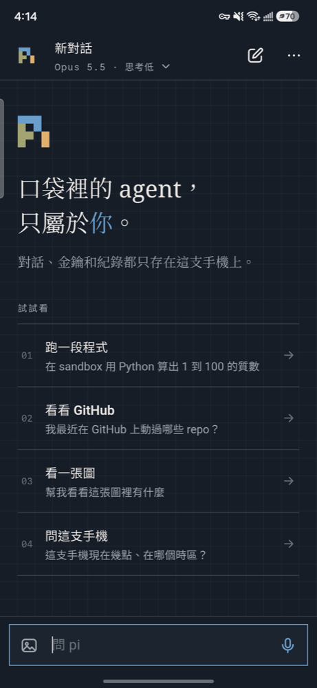
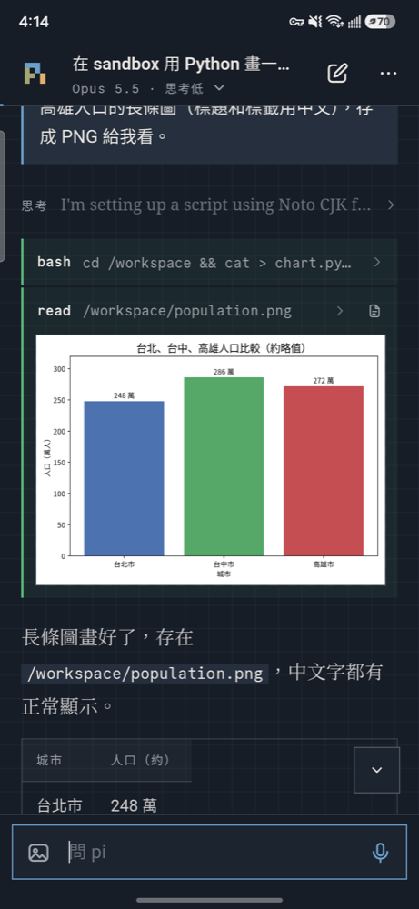
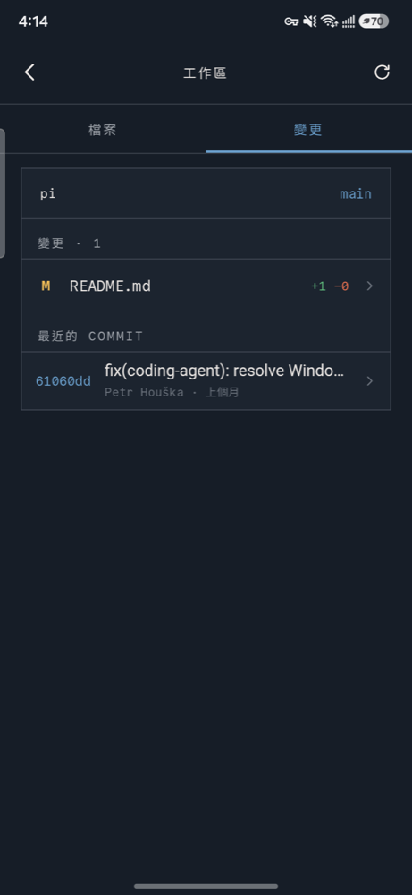
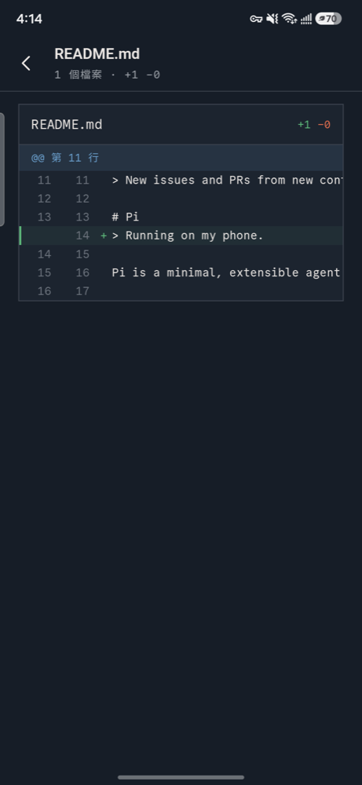

<p align="center"></p>

<h1 align="center">pi mobile</h1>

<p align="center"><b>非官方的社群專案</b>：不是 <a href="https://pi.dev">pi</a> 官方產品，與 Earendil 沒有關聯，也沒有經過他們背書。</p>

<p align="center">把 coding agent 放進口袋：agent loop 直接跑在你的 Android 手機上，<br>程式碼在你自己電腦上的 sandbox 裡執行，憑證和對話都不經過第三方。</p>

<p align="center">




</p>

pi mobile 是 [pi](https://pi.dev) 的手機版實驗：用 [pi-durable](https://pi.dev) 的 harness 在手機上跑 agent，用 [pi-env](https://pi.dev) 把 `read`、`write`、`edit`、`bash` 接到你自己電腦上的 Linux 容器。介面是繁體中文。

- **Agent 在手機上跑**：對話和執行狀態存在手機的 SQLite。鎖上螢幕或切到背景時會繼續跑；就算 app 被系統殺掉，下次打開也會從中斷的地方接著跑。
- **模型用你自己的 key**：任何 OpenAI 或 Anthropic 相容的 API 都能接，例如 OpenAI、Anthropic，或自架的 gateway（[CLIProxyAPI](https://github.com/router-for-me/CLIProxyAPI)、LiteLLM）。
- **Sandbox 在你自己的電腦上**：每個對話有一個獨立的 Linux 容器。主機端一支腳本安裝，手機掃 QR code 配對。
- **憑證不進 sandbox**：容器裡的 `git`、`gh`、`gcloud`、`cf`、`wrangler`、`az` 都已登入你的帳號，但 token 由中間的 proxy 注入，容器裡只有佔位字串。**所有寫入都要你在手機上按「允許」**。

> 這是個人專案，還在早期。它會用你的帳號執行指令，請先讀過[安全模型](#安全模型)。

## 開始使用

1. **安裝 app**：從 [Releases](../../releases) 下載 `pi-mobile-<版本>.apk` 安裝（需要允許「安裝未知應用程式」）。需要 Android 7.0 以上、arm64 手機。
2. **填模型服務**：第一次打開時，填上 OpenAI 或 Anthropic 相容 API 的網址和 key，按「開始」。到這一步就能聊天、搜尋網路、在手機上跑 code mode 腳本。
3. **（選用）安裝 sandbox 主機**：要讓 agent 跑指令、改程式碼，在一台 Mac 或 Linux 電腦上執行 `sandbox/install.sh`（見[安裝 sandbox 主機](#安裝-sandbox-主機)），再用手機相機掃它印出的 QR code。手機和主機要在同一個 [Tailscale](https://tailscale.com) 網路（或區網）。
4. **（選用）連接帳號**：在設定裡連接 GitHub、Google Cloud、Cloudflare、Azure，sandbox 裡對應的 CLI 就會以你的身分運作。
5. **背景執行**：設定頁「背景執行」裡允許通知，並讓 app 不受電池最佳化限制，長任務在鎖屏時才不會被系統暫停。

## 功能

**對話**
- 多個對話，依日期分組，可以搜尋、重新命名、刪除；執行中的對話有閃爍標記。
- 模型和思考強度選單，模型清單取自模型服務的 `/v1/models`。
- Agent 工作時可以「插話」（插到下一輪工具之後）或「稍後」（等這次跑完）。排隊的訊息可以撤回；按停止時，排隊的訊息會放回輸入框。
- 點自己的訊息可以複製，或「從這裡分支」開新對話。
- 壓縮對話、開始新的上下文、上下文用量和 token 統計。
- Markdown 回答、程式碼區塊一鍵複製、思考過程可以收合；工具步驟即時顯示輸出和經過秒數。

**輸入**
- 文字、圖片，以及**語音**：輸入框是空的時候，送出鈕會變成麥克風。用系統的語音辨識（繁體中文），結果放進輸入框讓你確認後再送。

**背景執行**
- 有對話在跑時，前景服務加 wake lock 讓 app 不被凍結，通知列顯示「pi 工作中」，鎖上螢幕也會繼續跑。
- App 不在前景時，跑完會通知「pi 完成了」，需要核准時會通知「pi 需要你確認」。

**工具**
- `web_search`：用模型服務本身的搜尋（OpenAI Responses 的 `web_search`，或 Anthropic 的 `web_search` server tool），不需要另外的搜尋 API key。`web_fetch`：從手機抓網頁並轉成文字。
- **手機的狀態與感測器**：每次只在 agent 呼叫時讀一次，不在背景追蹤。
  - `device_info`：電量、充電、省電模式、網路（Wi-Fi 或行動網路、VPN）、鈴聲模式、勿擾、連接的耳機、剩餘空間。
  - `get_location`：位置和地址（Android 內建的地址反查，不需要 API key）。只要「使用 app 時」的定位權限。
  - `read_sensors`：氣壓和估算海拔、指南針方位、環境光、距離感測。
- `github_api`、`github_read_file`：從手機直接呼叫 GitHub REST API。
- **交給手機上的其他 app**：
  - `list_calendars`、`add_calendar_event`：直接寫進指定的行事曆。手機上常同時有公司和個人的帳號，所以有多個帳號時 agent 會先問你要用哪個，寫入前的確認框也會寫明帳號。
  - `compose_email`、`compose_sms`：打開草稿，由你按「傳送」。
  - `open_maps`：打開 Google Maps 的路線。
  - `open_link`：用對應的 app 打開網址或 deep link（`geo:`、`tel:` 只開撥號畫面、`spotify:` 等）。
  - `share`：打開分享選單，可以把 sandbox 裡的檔案（圖表、PDF）傳到 LINE、Drive 等。
  - `set_alarm`、`set_timer`：直接設定鬧鐘和計時器，不開時鐘 app。
  - Android 不允許背景的 app 打開其他 app，所以 pi 在背景時這些工具會失敗，並請你回到 pi。
- **Code mode**：模型可以寫 JavaScript，在一個腳本裡批次呼叫工具（`tools.<name>(args)`）、整理資料。腳本在手機上的 QuickJS VM 裡跑，VM 放在 Web Worker 裡，所以不會卡住 UI；每個結果都先記下來，app 被殺掉後會接著跑。
- Sandbox 的 `read`、`write`、`edit`、`bash`，見下面。

**工作區**
- 瀏覽 sandbox 的 `/workspace`、看檔案（行號、Markdown 預覽、圖片）、每個 git repo 的變更、diff 和最近的 commit。
- Agent 用 `read` 讀回來的圖片（圖表、轉檔後的照片）會直接顯示在對話裡；工具步驟上的檔案圖示會在工作區打開那個檔案。

**操作**
- Android 返回手勢依序關閉最上層的畫面；什麼都沒開時，app 退到背景，不會被關掉。
- 從螢幕左緣往右滑打開對話列表。

## 架構

```
┌──────────────── 手機 (Capacitor WebView) ────────────────┐
│ React UI                                                  │
│ pi-durable harness ── SQLite（對話、執行狀態）              │
│   ├─ 模型、web_search ───── HTTPS ──▶ 模型服務              │
│   ├─ github_api、web_fetch ─ HTTPS ──▶ 網路                 │
│   ├─ code mode ──────────── Web Worker（QuickJS）           │
│   └─ coding tools ───────── WebSocket ─┐                    │
│ EgressLink（token、寫入核准）── WebSocket ┤                    │
│ AgentService（前景服務，背景執行）          │                    │
└──────────────────────────────────────────┼───────────────────┘
                                           │ Tailscale
┌───────── Sandbox 主機（Mac：colima VM；Linux：rootless Docker）┐
│ relay (server.mjs) ◀─────────────────────┘                   │
│   ├─ docker exec ─▶ sbx-c<id>：pi-env serve，/workspace        │
│   └─ /egress/authorize ◀── pi-egress（mitmproxy）              │
│                    只攔 GitHub、Google、Cloudflare、Azure， │
│                              換上真的 token，寫入先問手機       │
└────────────────────────────────────────────────────────────────┘
```

**為什麼 agent 跑在手機上？** 對話和金鑰都只在手機上，不需要一直開著的伺服器，換 sandbox 主機也不影響對話紀錄。

**為什麼用 Capacitor？** WebView 是 pi-ai 正式支援的瀏覽器環境，串流和 WASM 都能直接用。

### Sandbox 連線

pi-env 的 `Connection` 只會用 `spawn` 啟動子行程，WebView 做不到。`src/agent/sandbox/ws-connection.ts` 是它的移植版：同樣的 frame 格式和 session 語意，只是傳輸改成 WebSocket。

Relay 收到連線後，確保容器存在且在執行，再跑 `docker exec -i <container> pi-env serve`，兩邊照搬 bytes，不解析 frame。容器第一次連線時才建立，閒置 30 分鐘後停止，檔案留在 volume 裡。同時最多跑 6 個容器，滿了會停掉最久沒用的那個。

### 憑證與 egress proxy

每個 sandbox 的 HTTP(S) 流量都經過 `pi-egress`（mitmproxy + `sandbox/egress/credentials.py`）。它只攔下表裡的主機，其他網站（pip、npm、apt）直接放行、不解密。Proxy 的 CA 在容器第一次連線時裝進去。

| | GitHub | Google Cloud | Cloudflare | Azure |
|---|---|---|---|---|
| 攔截的主機 | `github.com`、`api.github.com`、`uploads.github.com`、`raw.githubusercontent.com` | `*.googleapis.com` | `api.cloudflare.com` | `management.azure.com`、`graph.microsoft.com`、`*.vault.azure.net`、Storage |
| 容器裡的佔位 | `GH_TOKEN` | `gcloud` 的 `auth/access_token_file` | `CLOUDFLARE_API_TOKEN`（`cf`、`wrangler` 都用它） | `az login --identity`：relay 扮演 managed identity 端點，發格式正確、沒有效力的 JWT |
| 登入方式 | 貼 fine-grained token | App 內 Google 登入，或貼 service account 金鑰 | App 內 Cloudflare 登入（`cf` 的 device flow），或貼 API token | App 內 Microsoft device code（az 的公開 client），代碼自動複製 |
| 真的憑證在哪 | 手機 Keystore；連線時交給 relay，只放記憶體，手機斷線 10 分鐘後丟掉 | 長期憑證**只在手機上**；relay 需要時請手機換一個短效 access token | 同 Google Cloud；refresh token 每次換新都會寫回 Keystore | 同 Cloudflare；每個 Azure 資源（ARM、Graph、Key Vault、Storage）各換一個 token |
| 直接放行（讀取） | clone、fetch、REST GET、GraphQL query | GET，以及只讀的 POST（`:list`、`:search`、`:get`、`:testIamPermissions` 等） | GET、GraphQL 分析 API | GET、Resource Graph 查詢、名稱檢查 |
| 要你核准（寫入） | `git push`、REST 的 POST/PATCH/PUT/DELETE、GraphQL mutation、LFS 上傳 | 其他所有請求 | 其他所有請求 | 其他所有請求，包括會回傳金鑰的 `listKeys` |

Sandbox 裡設了 `NODE_USE_ENV_PROXY=1`：Node 24 內建的 `fetch` 預設不走 `HTTPS_PROXY`，不設的話 `cf` 這類工具會繞過 proxy。

被拒絕時，git、gh、gcloud、cf、wrangler、az 都會顯示 `pi mobile: 使用者拒絕了這個寫入`。手機沒連上時，讀取不帶憑證送出，寫入一律拒絕。

**登入用的 OAuth client**：Google、Cloudflare、Azure 的 app 內登入，借用的是各家官方 CLI 公開發布的 client（`gcloud auth application-default login`、`cf auth login`、`az login` 用的同一組），所以同意頁上顯示的是那些 CLI 的名稱。這讓你不用自己去各家註冊 OAuth app；代價是哪天供應商限制這些 client，登入就可能失效。

## 專案結構

| 路徑 | 內容 |
|---|---|
| `src/agent/runtime.ts` | `AgentRuntime`：harness、對話索引、每個對話的控制器、執行狀態（task graph） |
| `src/agent/models.ts` | 模型服務的 provider：Claude 走 anthropic-messages，gpt-5.6/gpt-6 走 openai-responses，其他走 openai-completions |
| `src/agent/tools/` | `device.ts`（`device_info`、`get_location`、`read_sensors`）、`github_api`、`github_read_file`、`web_search`、`web_fetch`；`apps.ts` 是交給其他 app 的工具（Intent） |
| `src/agent/codemode.ts`、`codemode-worker.ts` | Code mode：`RemoteCodemodeSandbox` 的 remote 是一個跑 `serveCodemodeRemote` 的 Web Worker |
| `src/agent/parse.ts`、`oauth.ts` | 邊界驗證（typebox schema）與三家雲端共用的 OAuth：原生 HTTP 加逾時、token 回應、device flow 輪詢 |
| `src/agent/gcloud.ts` | Google 憑證：app 內登入（PKCE）、refresh token 換 access token，或用 WebCrypto 簽 service account 的 JWT |
| `src/agent/cloudflare.ts` | Cloudflare 憑證：device flow 登入、refresh token 輪替 |
| `src/agent/azure.ts` | Azure 憑證：Microsoft device code 登入、每個資源各自換 token |
| `src/agent/sandbox/` | `ws-connection.ts`（pi-env over WebSocket）、`sandbox.ts`（每個對話的 env 和環境說明）、`egress.ts`（控制通道）、`workspace.ts`（檔案與 git） |
| `src/storage.ts` | pi-durable 的 SQLite adapter（Capacitor SQLite，WAL） |
| `src/settings.ts` | 設定；密鑰存在 Keystore |
| `src/shims/` | 讓 pi-env 的 Node import 能在瀏覽器打包 |
| `src/app/` | React UI；`docs.ts` 以 pi-durable 的文件 token 型別讀取對話狀態；`keepAlive.ts`、`voice.ts`、`pairing.ts` 是對應 Android 原生功能的那一層 |
| `android/.../AgentService.java`、`KeepAlivePlugin.java`、`VoicePlugin.java`、`AppsPlugin.java`、`CalendarPlugin.java`、`PhonePlugin.java` | 前景服務與通知、語音辨識、用 Intent 交給其他 app、行事曆、位置與感測器 |
| `sandbox/` | Sandbox 主機端：image、relay、egress proxy、安裝腳本 |
| `scripts/` | Android 建置（開發版、發布版）與安裝、圖示產生 |
| `test/` | 手機上的 UI 測試（CDP）、sandbox、GitHub 和 gcloud egress 的 Node 端到端測試 |

## 從原始碼建置 app

需要：
- Node 24
- JDK 21：Capacitor 8 / AGP 8.13 要求，腳本預設用 Homebrew 的 `openjdk@21`。
- Android SDK（platform 36、build-tools 36），裝在 `~/Library/Android/sdk`。
- 開了 USB 或無線偵錯的 Android 手機。

```sh
npm ci --ignore-scripts
./scripts/build-android.sh            # 產生 pi-mobile.apk（release、R8 壓縮，只含 arm64）
./scripts/run-android.sh <adb serial> # 安裝、重開 app、轉發 WebView DevTools
```

`build-android.sh` 是**開發版**：用本機的 debug keystore 簽章，所以可以反覆覆蓋安裝而不刪掉手機上的對話；WebView 遠端除錯是開著的，方便用 `test/ui.sh` 在手機上操作測試。

發布用的版本：

```sh
./scripts/release-android.sh   # 產生 pi-mobile-<package.json 版本>.apk，印出 SHA-256
```

它用 `~/.config/pi-mobile/release.env` 指定的私鑰簽章（金鑰不在 repo 裡），**關閉遠端除錯**，並從 `package.json` 帶入版本號。不同金鑰簽的 APK 不能互相覆蓋安裝，要先移除舊的（手機上的對話會一起刪掉）。

第一次打開時填：
- **模型服務**：OpenAI 或 Anthropic 相容 API 的 URL 和 key。
- **Sandbox**（選填）：掃描 sandbox 主機安裝時印出的 QR code，見下一節。
- **GitHub**（選填）：fine-grained token，只開需要的 repo。
- **Google Cloud**（選填）：按「登入」用 Google 帳號登入。瀏覽器最後一頁會顯示授權碼，複製後回到 app 會自動帶入。流程和 `gcloud auth application-default login --no-launch-browser` 相同，用的是 gcloud 本身的 OAuth client。也可以改貼 service account 金鑰。可以設預設專案。
- **Cloudflare**（選填）：按「登入」，在瀏覽器確認代碼並同意，app 會自動完成。也可以改貼 API token。
- **Azure**（選填）：按「登入」，代碼會自動複製，在 Microsoft 的頁面貼上並同意。
- **背景執行**：允許通知，並讓 app 不受電池最佳化限制。

每一組都有「測試連線」，設定頁最下面顯示目前安裝的版本（commit 和建置時間）。

## 安裝 sandbox 主機

主機可以是 Mac（Apple silicon）或 Linux arm64，需要 Node 22+、Tailscale，以及 colima（Mac）或 rootless Docker（Linux）。在主機上執行：

```sh
sandbox/install.sh
```

這個腳本會：
- **Mac**：開一個專用的 colima VM（`pi-sandbox`，4 核、4 GB、40 GB），容器跑在這個 VM 裡，跟 Mac 本身隔了一層 VM。relay 用 launchd 在登入時啟動，log 在 `~/Library/Logs/pi-sandbox-relay.log`。
- **Linux**：用目前使用者的 rootless Docker，relay 是 systemd user service。
- 建置兩個 image：
  - `pi-sandbox`：Debian 13、Node 24（npm、pnpm）、Python 3.13 + uv、git、gh、gcloud、cf、wrangler、az、build-essential、sqlite3、ImageMagick、ffmpeg、pandoc、poppler-utils、Noto CJK 字型。
  - `pi-egress`：mitmproxy 12.2.3 加 `credentials.py`。
- 第一次安裝時在 `~/.config/pi-sandbox/env` 產生 `RELAY_TOKEN` 和 `EGRESS_SECRET`。
- 最後印出**配對 QR code** 和 `pimobile://pair?...` 連結。用手機相機掃描，pi mobile 會先測試連線、問你一次，然後自動填好設定。

再跑一次 `install.sh` 就是更新，token 會保留，不用重新配對。之後要再印一次配對碼：

```sh
node --env-file=$HOME/.config/pi-sandbox/env ~/pi-sandbox/relay/pair.mjs
```

從別台電腦安裝到遠端 Linux 主機：`sandbox/deploy.sh <ssh 目標>`，它會把 `sandbox/` 和 pi-env 複製過去再執行 `install.sh`。

## 測試

```sh
npm run check                                   # 型別檢查

# 手機上的 UI（先跑 run-android.sh 轉發 DevTools）
CDP_PORT=9333 ./test/ui.sh 'async () => { click("新對話"); return messages(); }'

# Sandbox 連線
SANDBOX_RELAY=ws://<主機>:8787 SANDBOX_TOKEN=... node test/sandbox-node.ts

# GitHub egress：腳本扮演手機，唯一放行的寫入是無害的 POST /markdown
SANDBOX_RELAY=ws://<主機>:8787 SANDBOX_TOKEN=... GITHUB_TOKEN=$(gh auth token) node test/egress-node.ts

# gcloud egress：腳本扮演手機並拒絕所有寫入，唯一嘗試的寫入是刪除一個不存在的 bucket
SANDBOX_RELAY=ws://<主機>:8787 SANDBOX_TOKEN=... GCLOUD_TOKEN=$(gcloud auth print-access-token) \
  GCLOUD_PROJECT=<專案> node test/gcloud-node.ts

# Cloudflare egress：同上，唯一嘗試的寫入是刪除一個不存在的 Worker
SANDBOX_RELAY=ws://<主機>:8787 SANDBOX_TOKEN=... CLOUDFLARE_TOKEN=<access token> \
  CLOUDFLARE_ACCOUNT=<account id> node test/cloudflare-node.ts
```

## 安全模型

| 資料 | 存放位置 |
|---|---|
| 對話、執行狀態 | 手機的 SQLite（未加密，`allowBackup=false`，不會進雲端備份） |
| 模型服務 key、GitHub token、relay token、Google、Cloudflare、Azure 憑證 | Android Keystore（`capacitor-secure-storage`） |
| GitHub token（sandbox 用） | 手機連線期間加 10 分鐘，放在 relay 的記憶體 |
| Google、Cloudflare、Azure access token | relay 的記憶體，到期為止；長期憑證不離開手機 |
| Sandbox 檔案 | 主機上每個對話一個 Docker volume；重置 sandbox 會刪除 |

- 所有 GitHub、Google Cloud、Cloudflare、Azure 的寫入都要在手機上核准，包括 sandbox 裡的 git、gh、gcloud、cf、wrangler、az，以及手機上的 `github_api` 工具。
- App 允許明文 HTTP（`network_security_config.xml`），因為自架的模型 gateway 和 relay 通常只透過 Tailscale 連線。
- 能登入 sandbox 主機那個帳號的人，可以讀到 relay 記憶體裡的 token，以及 egress 的 CA 私鑰。
- Relay 用一個 token 驗證手機，用明文 WebSocket 傳輸；請只在 Tailscale 這類加密的私人網路上使用，不要把 relay 開到公網。
- 發布版關閉 WebView 遠端除錯。開發版（`build-android.sh`）是開著的：能用 adb 連上手機的人可以操作 app。
- Agent 拿得到你給它的權限：GitHub 建議用只開必要 repo 的 fine-grained token；雲端帳號建議用權限小的專案或訂閱。

## 已知限制

- 只有 Android。iOS 需要 Xcode 和 Apple Team ID，還沒做。
- Sandbox image 只有 arm64（打包 `pi-env-linux-arm64`）。
- Sandbox 沒有互動式終端機（PTY），vim、REPL 這類程式不能用。
- `aws` 還沒支援。
- `az` 在 sandbox 裡是 managed identity，所以 `az ad signed-in-user show` 這類「我是誰」的指令不能用；還沒在有訂閱的帳號上測過建立資源。
- 只用自架 gateway（CLIProxyAPI）實測過，直連 OpenAI、Anthropic 官方 API 還沒測。
- 介面只有繁體中文。
- 鎖屏時，手機的網路偶爾會短暫中斷，正在跑的 sandbox 指令會失敗，agent 會自己重試。

## 關於這個專案

pi mobile 是非官方的社群專案，與 [pi](https://pi.dev) 的開發者 Earendil 沒有任何關聯，也不是他們的產品。它使用 npm 上公開發布的 pi 套件（`@earendil-works/pi-durable`、`pi-ai`、`pi-env`、`pi-codemode`、`chord`），問題和建議請開在這個 repo，不要回報給 pi 官方。App 圖示沿用 pi 標誌的像素形狀，改用 pi.dev 網站的配色，以示致敬。

## 授權

[MIT](LICENSE)。
